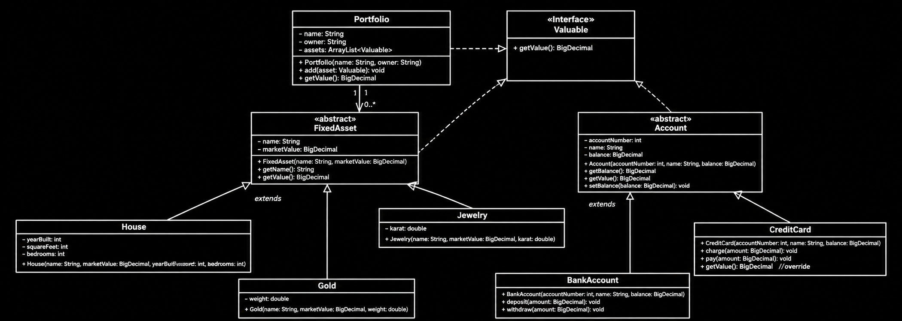

# Understanding Interfaces and Method Accessibility
## Questions and Answers

### 1. Did the deposit work for both accounts? Why or why not?

No, the deposit only works for account1 because it is declared as a BankAccount. The deposit for account2 causes a compilation error because it is declared as Valuable, which doesn't have a deposit() method.

### 2. What methods are available for account1?

account1 can use all accessible methods in the BankAccount class, including deposit(), withdraw(), and getValue(), along with inherited methods.

### 3. What methods are available for account2?

account2 can only use getValue() from the Valuable interface, along with methods inherited from Object, unless it is cast to a more specific type.

### 4. Why?

Java determines which methods are available based on the variable's declared type, not the object it references.

## Diagram:
